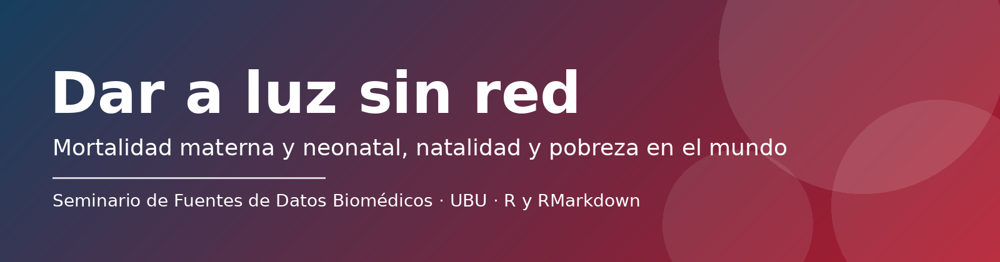

# Dar a luz sin red: mortalidad materna y neonatal, natalidad y pobreza en el mundo

Seminario de la asignatura **Fuentes de Datos Biomédicos y Web Semántica**
(Grado en Ingeniería de la Salud, Universidad de Burgos, curso 2026-2027).

**Autora:** Yousra El Jarjini

## Acerca de este proyecto

Este trabajo estudia, a escala mundial, por qué en unos países las mujeres embarazadas y los recién nacidos mueren con mucha más frecuencia que en otros. Comparamos los países del mundo con datos disponibles usando datos públicos del Banco Mundial (*World Development Indicators*), y relacionamos las muertes maternas y neonatales con cuatro factores: la **fecundidad**, la **pobreza**, la **atención sanitaria en el parto** y la **contaminación del aire**.

Todo el análisis está hecho en **R y RMarkdown**: se importan los datos desde archivos CSV, se limpian y se unen con *joins*, se guardan también en formato JSON, y se representan con mapas, gráficos, correlaciones de Spearman y un modelo de regresión lineal. El documento final se genera en HTML y contiene el texto, el código y sus resultados.

El seminario completo está en el archivo `.html` de este repositorio: descárgalo y ábrelo en el navegador para verlo bien.

## Introducción

Cada año mueren muchas mujeres por causas relacionadas con el embarazo y el parto, y muchos recién nacidos mueren durante su primer mes de vida. La mayoría de estas muertes se deben a causas conocidas y evitables: hemorragias, infecciones y problemas de tensión arterial en las madres; y prematuridad, falta de oxígeno al nacer e infecciones en los bebés. Casi siempre se pueden evitar con personal cualificado, medicamentos y un centro de salud al que llegar a tiempo.

Sin embargo, el lugar donde nace una persona sigue marcando enormemente sus probabilidades de sobrevivir. Con este trabajo queremos ver, con datos, cómo se reparten estas muertes en el mundo, cómo han cambiado desde el año 2000, y qué factores aparecen asociados a ellas. También analizamos el caso de Estados Unidos, un país rico con la mortalidad materna más alta entre los países de ingresos altos, para comprobar que la riqueza media de un país no basta para garantizar un parto seguro.

## Objetivos

1. **Descripción espacial:** países donde se concentran las muertes maternas y neonatales.
2. **Descripción temporal:** evolución entre 2000 y 2023 según el nivel de ingreso del país.
3. **Fecundidad:** relación entre la fecundidad y la mortalidad materna y neonatal.
4. **Pobreza, atención sanitaria y ambiente:** relación de la mortalidad con la pobreza, los partos atendidos por personal cualificado y la contaminación del aire.

## Algunos resultados

**1. Dónde se concentran las muertes.** Los diez países con mayor mortalidad materna son de ingreso bajo o medio-bajo, y nueve de ellos están en África. Encabezan la lista Nigeria (993 muertes por 100.000 nacidos vivos) y Chad (748). La mediana de los países de ingreso bajo es de 354 muertes maternas por 100.000 nacidos vivos, frente a 8 en los de ingreso alto (unas 44 veces más). En mortalidad neonatal, la diferencia es de 24,2 frente a 2,6 por 1.000 nacidos vivos (unas 9 veces más).

**2. Ha mejorado, pero las diferencias se mantienen.** Entre 2000 y 2023 todos los grupos de ingreso reducen su mortalidad (mediana por grupo):

| Grupo de ingreso | Muertes maternas 2000 → 2023 (por 100.000) | Muertes neonatales 2000 → 2023 (por 1.000) |
|---|---|---|
| Ingreso bajo | 786 → 354 (−55 %) | 42,9 → 24,2 (−44 %) |
| Ingreso medio-bajo | 378 → 146 (−61 %) | 31,0 → 18,7 (−40 %) |
| Ingreso medio-alto | 68,5 → 43,0 (−37 %) | 15,4 → 7,6 (−51 %) |
| Ingreso alto | 12,5 → 8,0 (−36 %) | 4,6 → 2,6 (−44 %) |

**3. Fecundidad y mortalidad van de la mano.** La correlación de Spearman de la fecundidad con la mortalidad materna es ρ = 0,80, y con la neonatal ρ = 0,79. Es una asociación, no una prueba de causa.

**4. Pobreza, atención sanitaria y ambiente.**

| Relación | Correlación de Spearman (ρ) |
|---|---|
| PIB per cápita y mortalidad neonatal | −0,84 |
| Partos atendidos por personal cualificado y mortalidad materna | −0,74 |
| Pobreza extrema y mortalidad neonatal | 0,78 |
| Combustibles limpios para cocinar y mortalidad materna | −0,80 |
| Combustibles limpios para cocinar y mortalidad neonatal | −0,75 |
| Contaminación PM2.5 y mortalidad neonatal | 0,46 |
| Contaminación PM2.5 y mortalidad materna | 0,37 |

En el modelo de regresión conjunto, duplicar el PIB per cápita se asocia con multiplicar la mortalidad neonatal por 0,7, y duplicar el PM2.5 con multiplicarla por 1,13, manteniendo iguales las demás variables.

## Conclusión

La geografía de la muerte materna y neonatal coincide con la de la pobreza, y las diferencias entre países ricos y pobres siguen siendo enormes aunque todos hayan mejorado. Lo que más pesa es la pobreza y la atención en el parto, y el ambiente también se asocia, pero va muy ligado a la pobreza. El caso de Estados Unidos muestra que ser un país rico no garantiza un parto seguro: importa menos la riqueza media que el apoyo y la atención que recibe cada mujer. Los resultados son **asociaciones entre países, no causas**, y apuntan a soluciones centradas en mejorar la atención sanitaria y garantizar el acceso voluntario a la planificación familiar.

## Datos

Los indicadores proceden del Banco Mundial (https://data.worldbank.org/). Cada archivo de la carpeta `Data` corresponde a un indicador:

| Código | Indicador |
|---|---|
| SH.STA.MMRT | Razón de mortalidad materna |
| SH.DYN.NMRT | Mortalidad neonatal |
| SH.DYN.MORT | Mortalidad de menores de 5 años |
| SP.DYN.TFRT.IN | Fecundidad |
| SH.STA.BRTC.ZS | Partos atendidos por personal cualificado |
| NY.GDP.PCAP.PP.CD | PIB per cápita (PPA) |
| SI.POV.DDAY | Pobreza extrema |
| EN.ATM.PM25.MC.M3 | Exposición a PM2.5 |
| EG.CFT.ACCS.ZS | Acceso a combustibles limpios para cocinar |

El archivo `Metadata_Country...csv` contiene el nombre, la región y el grupo de ingreso de cada país.

## Fuentes principales

- World Bank. *World Development Indicators*. https://data.worldbank.org/
- Gunja, M. Z., Gumas, E. D., Masitha, R., & Zephyrin, L. C. (2024). *Insights into the U.S. maternal mortality crisis: An international comparison*. Commonwealth Fund.
